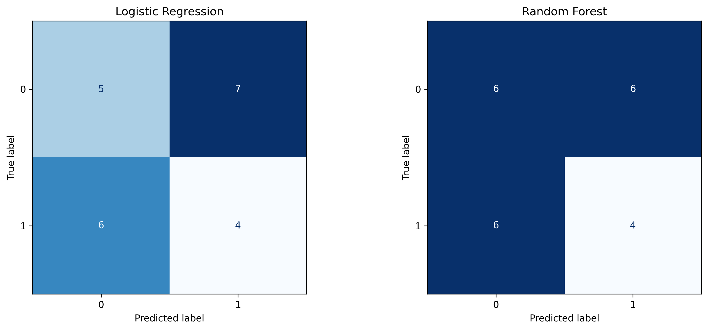
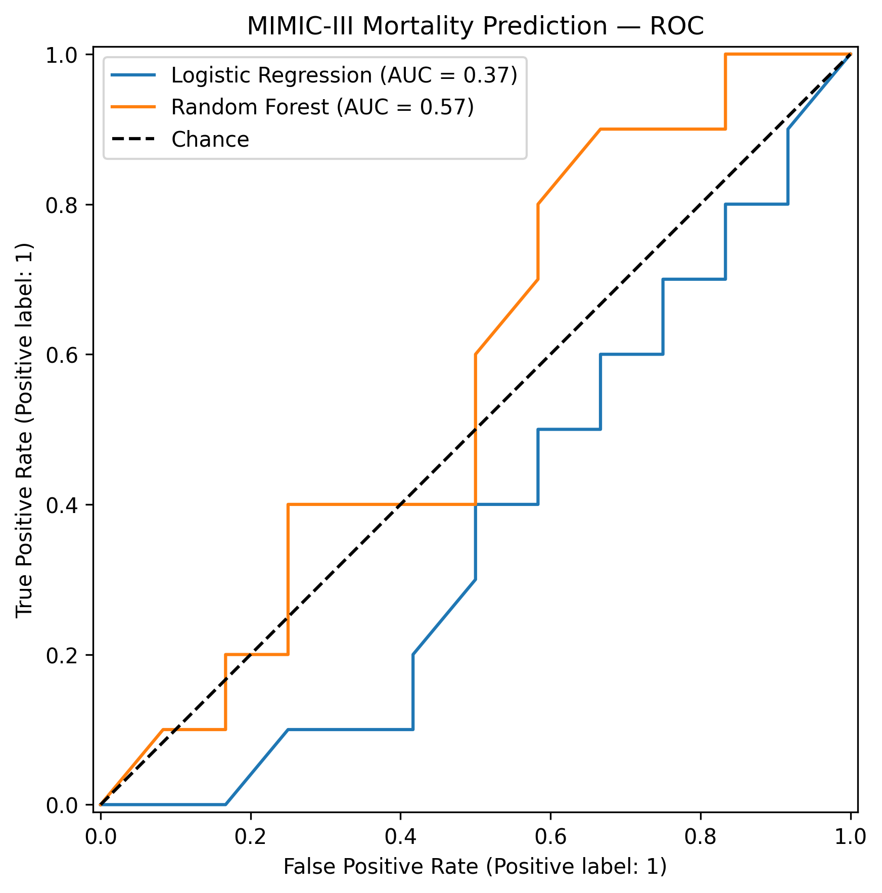

# healthcare-data-integration-fairness
An empirical analysis of fairness risks in healthcare data integration using Python and machine learning.
# Healthcare Data Integration & Fairness Analysis

## Project Overview
This project investigates fairness risks in healthcare machine learning, with particular attention to how data integration and preprocessing decisions can affect model performance across demographic groups.

## Research Objectives
- Explore missing data and demographic distributions.
- Examine preprocessing and data integration decisions.
- Train and evaluate Logistic Regression and Random Forest models.
- Investigate model fairness using demographic subgroup metrics.
- Identify potential risks and limitations in healthcare prediction pipelines.

## Tools and Technologies
Python, Google Colab, pandas, NumPy, Matplotlib, scikit-learn, and Fairlearn.

## Methodology
The analysis includes exploratory data analysis, preprocessing, predictive modelling, model evaluation, and fairness assessment.

## Results
Results, visualisations, and key findings will be documented here after verification against the completed notebook.

## Notebook
([View the analysis notebook](notebooks/Healthcare_Fairness_Analysis.ipynb))

## Reproducibility
Dataset access instructions, dependencies, and execution steps will be added here. Restricted clinical data will not be redistributed.

## Limitations
Findings should be interpreted in light of dataset characteristics, subgroup sizes, and the limitations of the fairness metrics used.
## MIMIC-III Hospital Mortality Prediction — Validated Baseline

### Project Overview

This experiment investigates hospital mortality prediction using the MIMIC-III clinical database demo dataset. It compares Logistic Regression and Random Forest models while examining how data preparation, patient-level splitting, and demographic subgroup differences affect model evaluation.

**Research objective:** Develop a reproducible exploratory machine learning baseline and assess potential fairness risks in healthcare prediction pipelines.

### Dataset and Methodology

- **Dataset:** MIMIC-III clinical database demo
- **Prediction target:** In-hospital mortality (`hospital_expire_flag`)
- **Features:** Age, gender and ethnicity
- **Training set:** 107 hospital admissions
- **Test set:** 22 hospital admissions
- **Train/test strategy:** Patient-level separation using `GroupShuffleSplit`
- **Patient overlap:** 0
- **Models:** Logistic Regression and Random Forest

Missing-value imputation, categorical encoding and numerical scaling are fitted on training data through scikit-learn pipelines. Class weighting is used instead of duplicating minority-class records before splitting.

### Model Performance

| Metric | Logistic Regression | Random Forest |
|---|---:|---:|
| Accuracy | 0.409 | 0.455 |
| Balanced accuracy | 0.408 | 0.450 |
| Precision | 0.364 | 0.400 |
| Recall | 0.400 | 0.400 |
| F1-score | 0.381 | 0.400 |
| ROC-AUC | 0.371 | 0.571 |
| Average precision | 0.390 | 0.509 |

Random Forest achieved higher observed performance on most metrics, although both models demonstrated weak predictive performance on the small held-out test set.

### Model Evaluation Visualisations

**Confusion matrices**

**ROC curves**

### Exploratory Fairness Analysis

Subgroup analysis was performed using Logistic Regression predictions.

| Gender | Test admissions | Positive prediction rate | True-positive rate |
|---|---:|---:|---:|
| Female | 11 | 0.818 | 0.750 |
| Male | 11 | 0.182 | 0.167 |

The observed difference in positive prediction rates was approximately 0.636.

This difference is descriptive and does not establish discriminatory behaviour. Small subgroup sizes, unequal outcome distributions and statistical uncertainty prevent definitive fairness conclusions.

Ethnicity subgroup evaluation was also conducted, but several groups contained fewer than five admissions, making the estimates particularly unstable.

### Limitations

- The held-out test set contains only 22 admissions.
- Results are sensitive to the patient split and small subgroup sizes.
- No external validation or statistical confidence intervals were performed.
- Only three demographic predictors were included.
- Model discrimination was weak, and the models are unsuitable for clinical deployment.
- Subgroup findings are exploratory rather than evidence of established discrimination.

### Reproducibility

The analysis notebook is available in the `notebooks/` directory.

The project uses Python, pandas, NumPy, scikit-learn and Matplotlib.

The underlying clinical data must be obtained through an appropriately authorised source and are not included in this public repository.

### Research Significance

[View the validated MIMIC-III analysis](notebooks/MIMIC_Fairness_Validated(2).ipynb)

This experiment illustrates why healthcare machine learning evaluation must consider data leakage, patient-level independence, class imbalance, demographic subgroup performance and uncertainty.

It forms part of a broader investigation into fairness risks arising from healthcare data integration and preprocessing decisions.
